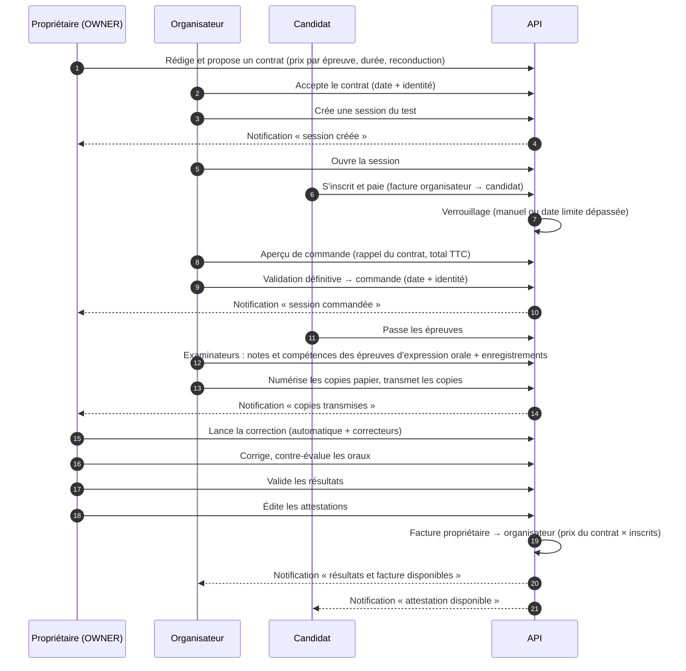
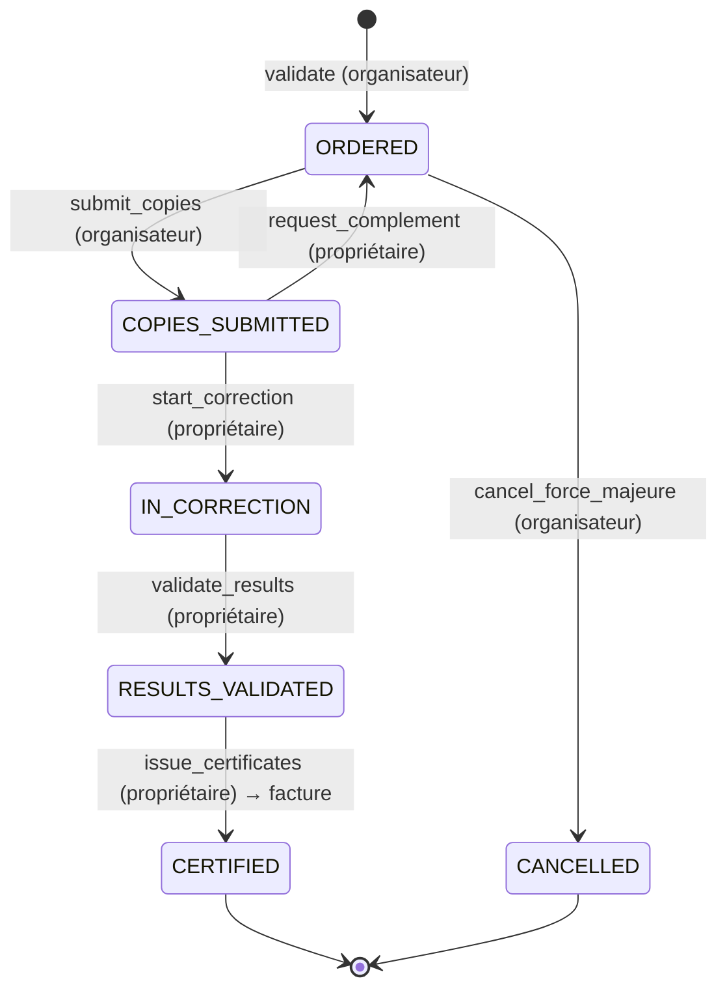
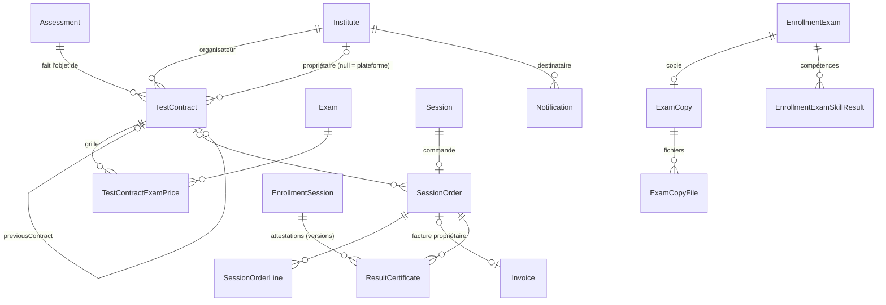

# Document de Conception - Contrats d'exploitation, Correction et Attestations

## Vue d'ensemble

Ce document décrit le modèle par lequel un institut (le **centre de passation**, ou **organisateur**) exploite un test dont il n'est pas le créateur (le **propriétaire**, ou **OWNER**), ainsi que le nouveau partage des rôles dans la correction, la validation des résultats et l'édition des attestations.

Il **remplace** :

- le « Process 2 : Achat de licence de test (TEST_LICENSE — B2B) » de `description-metier.md`. Il n'y a plus d'achat : l'exploitation d'un test repose sur un **contrat** à durée déterminée ;
- la règle « un examinateur est le seul qui a la possibilité d'éditer les fiches de résultats » de `description-metier.md`. Désormais, **seul le propriétaire du test valide les résultats et génère les attestations** ;
- les endpoints `POST /institutes/{id}/ownerships` (type `BUYER`) de `api-specifications.md`. Le lien acheteur est remplacé par le contrat.

Les décisions métier de ce document viennent du porteur du projet (octobre 2026). Les points qu'il n'a pas encore tranchés sont signalés **[À valider]** et regroupés dans la section [Questions ouvertes](#questions-ouvertes).

### Dépendances

- **hierarchie-assessment** : `Assessment`, `AssessmentOwnership(OWNER)`, `Exam`, `Skill`, `InstituteExamPricing`
- **sessions-inscriptions** : `Session` (workflow `session_lifecycle`), `ScheduledExam`, `EnrollmentSession`, `EnrollmentExam`
- **instituts-membres** : `InstituteMembership`, rôles `ADMIN` / `STAFF` / `TEACHER`
- **paiements-facturation** : `Invoice`, `InvoiceLine`, `Counterparty`, `Payment`, `InvoiceService`, Stripe Connect
- **Documents** : `DocumentType`, `DocumentTemplate`, `SessionDocumentPublication`, `DocumentAccessService`
- **Passage en ligne** : `Subject`, `CandidateResponse`, `ResponseGraderService`, `ExamFinisher`

### Vocabulaire

| Terme | Définition |
|---|---|
| **Propriétaire (OWNER)** | Créateur du test. C'est l'institut ayant un `AssessmentOwnership` de type `OWNER`, ou la **plateforme** si `Assessment.isInternal = true`. |
| **Organisateur / centre de passation** | Institut qui organise la session (`Session.institute`), inscrit et encaisse les candidats. |
| **Contrat d'exploitation** | Accord entre le propriétaire et un organisateur, pour un test. Il fixe un prix par épreuve, une durée et une éventuelle reconduction, et ouvre le droit d'organiser des sessions de ce test. |
| **Commande** | Engagement de l'organisateur envers le propriétaire, créé à la **validation définitive** de la session. Il fige le prix du contrat et le nombre d'inscrits par épreuve. |
| **Copie** | Production d'un candidat pour une épreuve : réponses en ligne, copie papier numérisée ou enregistrement oral. |
| **Contre-évaluation** | Réécoute d'une épreuve orale par le propriétaire, qui peut confirmer ou remplacer la note de l'examinateur. |
| **Attestation de résultat** | Document officiel des résultats d'un candidat, édité **uniquement** par le propriétaire. |
| **Session auto-organisée** | Session dont l'organisateur est aussi le propriétaire du test. Elle ne donne lieu à aucun contrat ni à aucune facture propriétaire → organisateur. |

### Principes de conception

1. **Pas d'achat, un contrat** : un organisateur n'exploite le test d'un autre que sous un contrat **en vigueur**. Ce contrat fixe un prix par épreuve, une durée et une éventuelle reconduction.
2. **Facturation à l'usage réel** : le propriétaire ne facture que les sessions **commandées**, c'est-à-dire validées définitivement par l'organisateur. La facture est émise **à l'édition des attestations**, donc quand les résultats sont disponibles.
3. **Deux factures, deux prix** :
   - **organisateur → candidat** : prix de vente de l'organisateur (`InstituteExamPricing`), facture d'inscription. Ce flux existe déjà ;
   - **propriétaire → organisateur** : prix du contrat × nombre d'inscrits par épreuve. C'est le nouveau flux.
4. **Les absents sont facturés, pas les désinscrits** : la quantité commandée est le nombre d'inscriptions actives à l'épreuve au moment de la commande. Après la validation définitive, il n'est plus possible de se désinscrire.
5. **Le propriétaire est l'autorité des résultats** : il déclenche la correction, contre-évalue les oraux, valide les résultats et édite les attestations. Les examinateurs de l'organisateur ne notent **que** les épreuves d'**expression orale**.
6. **La plateforme est un propriétaire comme un autre** : les tests internes (TOEIC, DELF…) suivent exactement le même mécanisme, avec la plateforme comme propriétaire.
7. **Traçabilité** : chaque acte engageant (acceptation de contrat, commande, validation des résultats, édition des attestations) enregistre **qui** et **quand**, et fige les données au moment de l'acte (snapshot).

---

## Exigences

### Exigence 1 : Contrat d'exploitation

1.1 Un contrat lie **un** test, **un** propriétaire et **un** organisateur.
1.2 Le contrat fixe, pour **chaque épreuve** du test (obligatoire ou optionnelle), un prix unitaire HT et un taux de TVA.
1.3 Le contrat a une date de début, une date de fin, et précise s'il est renouvelable.
1.4 Le contrat est rédigé par le propriétaire, puis proposé à l'organisateur, qui l'accepte ou le refuse. L'acceptation enregistre la date et l'identité de la personne qui accepte.
1.5 Une fois proposé, un contrat n'est plus modifiable. Toute modification passe par un nouveau contrat, qui succède au précédent.
1.6 Pour un même test et un même organisateur, deux contrats acceptés ne peuvent pas avoir de périodes qui se chevauchent.
1.7 Un contrat **en vigueur** (accepté, et dont la date du jour est dans sa période) ouvre à l'organisateur le droit d'organiser des sessions du test.
1.8 Les termes du contrat (conditions, prix, période) restent consultables par les deux parties, y compris après son expiration.

### Exigence 2 : Droit d'organiser une session

2.1 Un institut peut créer une session d'un test s'il en est propriétaire, ou s'il dispose d'un contrat en vigueur pour ce test.
2.2 L'ouverture (`open`) et la validation définitive (`validate`) d'une session exigent un contrat en vigueur au moment de l'action, sauf pour une session auto-organisée.
2.3 Une session déjà commandée poursuit son cycle (correction, résultats, attestations, facture) même si le contrat expire entre-temps.

### Exigence 3 : Information du propriétaire

3.1 Le propriétaire est notifié dès qu'une session de son test est **créée** chez un organisateur, même à l'état de brouillon.
3.2 Il est aussi notifié à l'ouverture, au verrouillage, à l'annulation et à la validation définitive (commande) de la session, ainsi qu'à la transmission des copies.
3.3 Le propriétaire voit la liste de toutes les sessions de ses tests, quel que soit leur organisateur, avec leur statut.

### Exigence 4 : Validation définitive et commande

4.1 La validation définitive n'est possible que si la session est **verrouillée** (`LOCKED`), que le verrouillage soit manuel ou automatique à l'expiration de la date limite d'inscription.
4.2 Avant de valider, l'organisateur voit un écran récapitulatif qui comprend :
- le rappel des termes du contrat avec le propriétaire ;
- le détail par épreuve : quantité, prix unitaire HT, TVA et totaux ;
- le **prix total TTC** dû au propriétaire.
4.3 La quantité d'une épreuve est le nombre d'inscriptions **actives** à cette épreuve au moment de la validation. Elle comprend les épreuves optionnelles choisies et les futurs absents.
4.4 Le prix appliqué est celui du contrat en vigueur au moment de la validation.
4.5 La validation définitive crée la commande et enregistre la **date** et **l'identité** de la personne qui valide.
4.6 Après la validation définitive :
- aucune désinscription n'est possible ;
- aucun transfert n'est possible ;
- aucune nouvelle inscription n'est possible.

4.7 Une session validée peut être **annulée pour cas de force majeure** (décision Q7), par l'ADMIN de l'organisateur, avec un motif obligatoire, tant que les copies n'ont pas été transmises au propriétaire. L'annulation enregistre la date, l'identité et le motif, annule la commande sans aucune facture du propriétaire, rembourse les candidats comme toute annulation de session, et notifie le propriétaire.

### Exigence 5 : Répartition de la correction

5.1 Les examinateurs de l'organisateur saisissent une note et valident des compétences **uniquement** sur les épreuves de type **expression orale**, et seulement pour les épreuves dont ils sont examinateurs.
5.2 Les autres membres de l'organisateur (ADMIN, STAFF) ne peuvent saisir ni modifier aucune note.
5.3 Le propriétaire reçoit les copies des candidats et **lance la correction**.
5.4 Le propriétaire accède aux épreuves orales (enregistrements) pour effectuer une **contre-évaluation**, dont la note prime sur celle de l'examinateur.
5.5 Seul le propriétaire **valide les résultats**. Après validation, aucune note n'est plus modifiable.

### Exigence 6 : Attestations et facturation

6.1 Seul le propriétaire génère les attestations de résultat, et seulement après avoir validé les résultats.
6.2 L'édition des attestations déclenche **une** facture du propriétaire à l'organisateur, d'un montant égal à celui de la commande.
6.3 La facture du propriétaire est émise une seule fois par commande. Une réédition d'attestation (correction d'une coquille, par exemple) ne refacture pas.
6.4 Les attestations deviennent consultables par l'organisateur et par les candidats après leur édition.
6.5 Pour une session auto-organisée, l'édition des attestations ne crée aucune facture.

---

## Architecture

### Parcours complet



### Cycle de vie de la session (inchangé) et cycle de la commande (nouveau)

Le workflow `session_lifecycle` (`config/packages/workflow.yaml`) reste DRAFT → OPEN → LOCKED → VALIDATED, avec CANCELLED. Seul ajout : la transition `cancel_from_validated` (VALIDATED → CANCELLED), réservée à la force majeure. Ce qui change, c'est le sens de `VALIDATED` : la session est **commandée auprès du propriétaire**. La suite (copies, correction, résultats, attestations) est suivie par une machine à états distincte, celle de la commande (`SessionOrder`). On évite ainsi d'alourdir le cycle de la session.



| Transition | Acteur | Gardes |
|---|---|---|
| `validate` (session) | ADMIN/STAFF de l'organisateur | session `LOCKED` ; contrat en vigueur (hors session auto-organisée) ; acceptation explicite du récapitulatif |
| `submit_copies` | ADMIN/STAFF de l'organisateur | date de fin de la dernière épreuve passée ; chaque épreuve d'expression orale a une note d'examinateur, ou le candidat est absent ; chaque copie attendue est présente ou le candidat est marqué absent |
| `request_complement` | ADMIN du propriétaire | motif obligatoire (copie manquante, enregistrement inaudible…) |
| `start_correction` | ADMIN du propriétaire | commande `COPIES_SUBMITTED` |
| `validate_results` | ADMIN du propriétaire | toutes les copies sont `CORRECTED` ou `ABSENT` |
| `issue_certificates` | ADMIN du propriétaire | commande `RESULTS_VALIDATED` ; modèle d'attestation disponible |
| `cancel_force_majeure` | ADMIN de l'organisateur, par la transition de session `cancel_from_validated` | commande `ORDERED` (copies non transmises) ; motif obligatoire |

**Annulation pour force majeure** (décision Q7) :
- `PATCH /api/sessions/{id}/transition` avec `{ "transition": "cancel_from_validated", "forceMajeureReason": "…" }`. Motif de 20 caractères minimum.
- Dans une seule transaction : session `CANCELLED`, commande `CANCELLED` (`cancelledAt`, `cancelledBy`, `cancellationReason`), remboursement des candidats par le `RefundService` existant (avoirs et remboursements Stripe), notification `SESSION_CANCELLED` au propriétaire avec le motif.
- Aucune facture propriétaire : une commande annulée n'est jamais facturée.
- Après la transmission des copies (`COPIES_SUBMITTED` et au-delà), l'annulation est refusée (409 `ORDER_IN_PROGRESS`), car le propriétaire a commencé son travail. **[À valider]** Si ce cas doit être possible, il passera par un accord du propriétaire.
- `SessionCancelPreviewController` affiche aussi, pour une session `VALIDATED`, le rappel que la commande sera annulée.
- La réouverture (`reopen`, CANCELLED → DRAFT) reste impossible, comme aujourd'hui dès que des candidats ont été remboursés.

Une session auto-organisée suit le même cycle de commande, avec un montant nul et sans facture. Toutes les actions, propriétaire comme organisateur, y sont faites par le même institut.

### Résolution du propriétaire

Un service unique, `AssessmentOwnerResolver`, est utilisé par tous les voters et processors. Il évite de réimplémenter la boucle sur les memberships dans chaque voter.

```php
interface AssessmentOwnerResolver
{
    /** Institut propriétaire, ou null si le test est interne (propriétaire = plateforme). */
    public function ownerInstitute(Assessment $assessment): ?Institute;

    public function isPlatformOwned(Assessment $assessment): bool;

    /** true si $user est membre ACTIF du propriétaire avec l'un des rôles (ou admin plateforme pour un test interne). */
    public function isOwnerMember(User $user, Assessment $assessment, array $roles = ['ADMIN']): bool;

    /** Session dont l'organisateur est aussi le propriétaire. */
    public function isSelfOrganized(Session $session): bool;
}
```

Pour un test interne, les actions du propriétaire sont faites par les **administrateurs de la plateforme** (`ROLE_PLATFORM_ADMIN`). Ce sont aussi eux qui sont notifiés à sa place.

### Structure des modules (API)

```
src/
├── Entity/
│   ├── TestContract.php                 # nouveau
│   ├── TestContractExamPrice.php        # nouveau
│   ├── SessionOrder.php                 # nouveau
│   ├── SessionOrderLine.php             # nouveau
│   ├── ExamCopy.php                     # nouveau
│   ├── ExamCopyFile.php                 # nouveau
│   ├── EnrollmentExamSkillResult.php    # nouveau
│   ├── ResultCertificate.php            # nouveau
│   ├── Notification.php                 # nouveau
│   ├── Exam.php                         # + examType
│   ├── EnrollmentExam.php               # + champs de correction
│   ├── Session.php                      # + validatedAt, validatedBy, order
│   └── Invoice.php                      # + buyerInstitute, sessionOrder
├── Enum/  (TestContractStatusEnum, SessionOrderStatusEnum, ExamTypeEnum,
│           ExamCopyStatusEnum, ExamCopySourceEnum, ResultStatusEnum,
│           ScoreSourceEnum, NotificationTypeEnum)
├── Service/
│   ├── AssessmentOwnerResolver.php
│   ├── TestContractService.php          # contrat en vigueur, chevauchements, reconduction
│   ├── SessionOrderService.php          # aperçu, création de commande, totaux
│   ├── CorrectionService.php            # lancement, affectation, note finale
│   ├── ResultCertificateService.php     # édition des attestations + snapshot
│   ├── PrivateFileStorage.php           # copies et enregistrements (hors public/)
│   └── InstituteNotifier.php            # notifications aux instituts (en base + email)
├── State/      (processors et providers listés plus bas)
├── Security/Voter/ (TestContractVoter, SessionOrderVoter, ExamCopyVoter, + modifications)
└── Command/    (app:contracts:expire-renew, app:contracts:notify-expiring)
```

---

## Composants et Interfaces

### 1. Contrats d'exploitation

| Méthode | Route | Droits | Description |
|---|---|---|---|
| `GET` | `/api/institutes/{id}/contracts` | membre ADMIN/STAFF | Contrats de l'institut, comme propriétaire **ou** comme organisateur. Filtres : `role=owner\|organizer`, `status`, `assessment`. |
| `GET` | `/api/test-contracts/{id}` | ADMIN/STAFF des deux parties, admin plateforme | Détail, avec la grille de prix. |
| `POST` | `/api/assessments/{id}/contracts` | ADMIN du propriétaire, ou admin plateforme pour un test interne | Crée un contrat `DRAFT` (organisateur, période, reconduction, conditions, prix). |
| `PATCH` | `/api/test-contracts/{id}` | ADMIN du propriétaire | Modifie un contrat, seulement en `DRAFT`. |
| `PUT` | `/api/test-contracts/{id}/prices` | ADMIN du propriétaire | Remplace la grille de prix, seulement en `DRAFT`. |
| `PATCH` | `/api/test-contracts/{id}/propose` | ADMIN du propriétaire | `DRAFT → PROPOSED`. Exige un prix pour chaque épreuve du test et aucun chevauchement. Notifie l'organisateur. |
| `PATCH` | `/api/test-contracts/{id}/accept` | ADMIN de l'organisateur | `PROPOSED → ACTIVE`. Enregistre `acceptedAt` et `acceptedBy`. Le corps doit contenir `{ "acceptTerms": true }`. |
| `PATCH` | `/api/test-contracts/{id}/refuse` | ADMIN de l'organisateur | `PROPOSED → REFUSED`, avec `refusalReason`. |
| `PATCH` | `/api/test-contracts/{id}/withdraw` | ADMIN du propriétaire | `PROPOSED → DRAFT`. |
| `PATCH` | `/api/test-contracts/{id}/terminate` | ADMIN d'une des deux parties | `ACTIVE → TERMINATED`. Enregistre `terminatedAt`, `terminatedBy` et `terminationReason`. Prend effet à `effectiveEndDate` (préavis). **[À valider]** |
| `POST` | `/api/test-contracts/{id}/renew` | ADMIN du propriétaire | Crée le contrat suivant (`DRAFT`), prérempli, avec `previousContract`. |
| `GET` | `/api/assessments/{id}/contracts` | ADMIN du propriétaire | Tous les contrats du test. |

**Contrat en vigueur** : `TestContractService::inForce(Assessment $a, Institute $organizer, \DateTimeInterface $at): ?TestContract` renvoie le contrat `ACTIVE` tel que `startDate <= at <= endDate`, ou dont la reconduction tacite couvre cette date (voir [Reconduction](#reconduction)).

**Catalogue** : le test d'un propriétaire n'est visible d'un autre institut que si un contrat le lie à cet institut. Il n'y a pas de catalogue public de tests à exploiter pour l'instant. **[À valider]** On pourrait ajouter plus tard une demande de contrat à l'initiative de l'organisateur.

#### Reconduction

- `renewable = false` : le contrat expire à `endDate`. Une commande `app:contracts:expire-renew`, lancée chaque nuit, le passe en `EXPIRED`.
- `renewable = true` : reconduction **tacite** (décision Q1). À `endDate`, si aucune des deux parties n'a résilié, la même commande crée le contrat suivant directement en `ACTIVE`. Il reprend les mêmes prix et conditions, pour une période de même durée (`renewalPeriodMonths`), avec `previousContract`. Le contrat d'origine passe en `EXPIRED`.
- **Préavis** : les deux parties sont notifiées `noticePeriodDays` avant `endDate` (`app:contracts:notify-expiring`), puis à l'expiration.
- **Changement de prix** : il passe toujours par un nouveau contrat, proposé puis accepté. La reconduction tacite ne change jamais les prix.

### 2. Sessions : création, information du propriétaire, validation définitive

Modifications des processors existants :

| Point d'entrée | Modification |
|---|---|
| `InstituteSessionCreateProcessor` | Vérifie que l'organisateur est propriétaire du test, ou qu'un contrat est en vigueur, sinon 403 `NO_ACTIVE_CONTRACT`. Après le flush : `InstituteNotifier::sessionCreated(session)` vers le propriétaire, sauf session auto-organisée. |
| `SessionWorkflowSubscriber::guardOpen` | Ajoute la garde « contrat en vigueur » (hors session auto-organisée). |
| `SessionWorkflowSubscriber` (`completed.*`) | Notifie le propriétaire à l'ouverture, au verrouillage, à l'annulation et à la validation. |
| `SessionTransitionProcessor` (`validate`) | Exige `acceptOrder: true` et `expectedTotalTTC`. Recalcule l'aperçu : si le total diffère (inscription ou prix modifié entre-temps), renvoie 409 `ORDER_CHANGED` avec le nouvel aperçu. Sinon, dans une **seule transaction** : transition, `Session.validatedAt/validatedBy`, création de la `SessionOrder` et de ses lignes. |
| `EnrollmentCancelProcessor`, transfert | Refusés si la session est `VALIDATED` (déjà implicite pour l'annulation, qui exige `OPEN` : à rendre explicite). Le transfert d'une inscription est refusé si la session d'origine **ou** la session cible est `VALIDATED`. |

| Méthode | Route | Droits | Description |
|---|---|---|---|
| `GET` | `/api/sessions/{id}/order-preview` | ADMIN/STAFF de l'organisateur | Données de l'écran de validation (voir ci-dessous). Disponible en `LOCKED`. |
| `GET` | `/api/assessments/{id}/sessions` | ADMIN/STAFF du propriétaire | Toutes les sessions du test, chez tous les organisateurs, pour l'écran « Sessions de mes tests ». |
| `GET` | `/api/institutes/{id}/owned-sessions` | ADMIN/STAFF/TEACHER du propriétaire | Sessions de tous les tests de l'institut organisées ailleurs. Filtres : `status`, `orderStatus`, `organizer`. |

Réponse de `GET /api/sessions/{id}/order-preview` :

```json
{
  "selfOrganized": false,
  "contract": {
    "id": "…", "reference": "CTR-2026-00012", "version": 2,
    "owner": { "name": "Institut Français", "siren": "…" },
    "startDate": "2026-01-01", "endDate": "2026-12-31",
    "renewable": true, "terms": "…", "acceptedAt": "…", "acceptedBy": "Camille Martin"
  },
  "lines": [
    { "exam": "/api/exams/…", "label": "Compréhension écrite", "optional": false,
      "quantity": 18, "unitPriceHT": 40.00, "tvaRate": 20.0,
      "totalHT": 720.00, "totalTVA": 144.00, "totalTTC": 864.00 }
  ],
  "totalHT": 1260.00, "totalTVA": 252.00, "totalTTC": 1512.00,
  "warnings": [
    "Les candidats absents seront facturés.",
    "Après validation, aucune désinscription ni aucun transfert ne sera possible.",
    "La facture du propriétaire sera émise à l'édition des attestations."
  ],
  "blockingReasons": []
}
```

Corps de la validation :

```json
PATCH /api/sessions/{id}/transition
{ "transition": "validate", "acceptOrder": true, "expectedTotalTTC": 1512.00 }
```

### 3. Types d'épreuve et saisie des examinateurs

**Nouveau champ** `Exam.examType` (`ExamTypeEnum`) :

| Valeur | Libellé |
|---|---|
| `READING` | Compréhension écrite |
| `LISTENING` | Compréhension orale |
| `WRITING` | Expression écrite |
| `SPEAKING` | Expression orale |
| `OTHER` | Autre (grammaire, vocabulaire…) |

C'est `SPEAKING` qui ouvre la saisie aux examinateurs. `isWritten` reste en place pour l'affichage. **Migration** **[À valider]** : `isWritten = false` devient `SPEAKING` et `isWritten = true` devient `OTHER`. Le propriétaire de chaque test devra ensuite qualifier ses épreuves : un bandeau sur la fiche du test liste les épreuves `OTHER`.

**Voter `ENROLLMENT_EXAM_SCORE`** (`EnrollmentExamVoter`), qui remplace la règle actuelle :

| Qui | Épreuves | Quand |
|---|---|---|
| Examinateur affecté au `ScheduledExam` (membre **actif** de l'organisateur) | `SPEAKING` uniquement | commande `ORDERED` (après la fin de l'épreuve) ou retour `request_complement` |
| Correcteur du propriétaire (ADMIN/TEACHER actif du propriétaire, affecté ou ADMIN) | toutes | commande `IN_CORRECTION` |
| ADMIN/STAFF de l'organisateur | **aucune** | — |
| Admin plateforme | toutes (support) | toujours tracé |

L'endpoint `PATCH /api/enrollment-exams/{id}/score` est remplacé par deux endpoints :

| Méthode | Route | Droits | Corps |
|---|---|---|---|
| `PATCH` | `/api/enrollment-exams/{id}/examiner-score` | examinateur, épreuve `SPEAKING` | `{ score, absent, skills: [{ skill, acquired }], comment }` |
| `PATCH` | `/api/enrollment-exams/{id}/correction` | correcteur du propriétaire | `{ score, absent, skills: [...], comment }` (contre-évaluation pour `SPEAKING`) |

Une saisie en lot (`PATCH /api/scheduled-exams/{id}/examiner-scores`, un tableau) évite les N requêtes actuelles de l'écran des résultats.

### 4. Copies

| Méthode | Route | Droits | Description |
|---|---|---|---|
| `GET` | `/api/sessions/{id}/copies` | ADMIN/STAFF de l'organisateur ; ADMIN/correcteurs du propriétaire | Copies attendues et reçues, par épreuve et par candidat (état de complétude). |
| `POST` | `/api/enrollment-exams/{id}/copy-files` | ADMIN/STAFF de l'organisateur, examinateur (`SPEAKING`) | Envoi (multipart) d'un scan (PDF, JPG, PNG) ou d'un enregistrement (MP3, M4A, WEBM, WAV). Taille maximale **[À valider]** : 20 Mo par fichier. |
| `DELETE` | `/api/exam-copy-files/{id}` | auteur de l'envoi | Possible tant que la commande est `ORDERED`. |
| `GET` | `/api/exam-copy-files/{id}/content` | mêmes droits que la lecture | Flux du fichier, via un contrôleur qui vérifie les droits (jamais une URL publique). |
| `PATCH` | `/api/session-orders/{id}/submit-copies` | ADMIN/STAFF de l'organisateur | `ORDERED → COPIES_SUBMITTED`. |
| `PATCH` | `/api/session-orders/{id}/request-complement` | ADMIN du propriétaire | `COPIES_SUBMITTED → ORDERED`, avec `{ reason, enrollmentExams: [...] }`. |

**Constitution des copies** :

| Type d'épreuve | Source | Création de la copie |
|---|---|---|
| Épreuve en ligne (sujet `LOCKED`) | `ONLINE` | Automatique à la fin de l'épreuve (`ExamFinisher`). Les réponses sont les `CandidateResponse` existantes. |
| Épreuve papier (`READING`, `LISTENING`, `WRITING`, `OTHER` hors ligne) | `UPLOAD` | Scan déposé par l'organisateur. |
| `SPEAKING` | `RECORDING` | Note de l'examinateur, plus l'enregistrement déposé par l'organisateur. L'enregistrement est **obligatoire** pour permettre la contre-évaluation (décision Q4) : sans lui, la transmission des copies est refusée (`COPIES_INCOMPLETE`). |
| Candidat absent | — | Copie au statut `ABSENT`, sans fichier. |

**Stockage** : `PrivateFileStorage` écrit hors de `public/` (`var/storage/copies/{sessionId}/…`), nomme les fichiers par UUID et vérifie leur type MIME réel. Le service est prévu pour être remplacé par un stockage objet (S3) sans toucher aux entités. La durée de conservation, imposée par le RGPD, reste à fixer **[À valider]**. Une commande de purge supprimera les fichiers au-delà de cette durée.

### 5. Espace de correction du propriétaire

| Méthode | Route | Droits | Description |
|---|---|---|---|
| `PATCH` | `/api/session-orders/{id}/start-correction` | ADMIN du propriétaire | `COPIES_SUBMITTED → IN_CORRECTION`. Recalcule les notes automatiques des copies `ONLINE`. Passe les copies `UPLOAD` et `RECORDING` en `TO_CORRECT`. |
| `PUT` | `/api/session-orders/{id}/correctors` | ADMIN du propriétaire | Affecte des correcteurs (TEACHER/ADMIN actifs du propriétaire) par épreuve : `{ scheduledExam, correctors: [userIri] }`. |
| `GET` | `/api/session-orders/{id}/correction-board` | ADMIN/correcteurs du propriétaire | Tableau de bord : avancement par épreuve et par correcteur, copies restantes. |
| `PATCH` | `/api/enrollment-exams/{id}/correction` | correcteur affecté, ou ADMIN du propriétaire | Note, compétences, commentaire. La copie passe en `CORRECTED`. |
| `PATCH` | `/api/session-orders/{id}/validate-results` | ADMIN du propriétaire | `IN_CORRECTION → RESULTS_VALIDATED`. Calcule les notes finales et les statuts PASSED/FAILED, puis fige. Enregistre `resultsValidatedAt/By`. Notifie l'organisateur. |

**Note finale** (`CorrectionService::finalScore`) :

1. copie `ABSENT` : pas de note, statut `ABSENT` ;
2. une note de correcteur existe : c'est elle (contre-évaluation pour `SPEAKING`, correction manuelle sinon) ;
3. sinon, pour `SPEAKING`, la note de l'examinateur ;
4. sinon, la note automatique (`ONLINE`).

Le statut PASSED/FAILED est calculé avec `Exam.successScore` (ou `Subject.passingScore` en ligne). La source retenue (`AUTO`, `EXAMINER`, `CORRECTOR`) est enregistrée.

### 6. Attestations de résultat

- **Nouveau `DocumentType`** : `RESULT_CERTIFICATE`, « Attestation de résultat ». Il est ajouté à `SeedDocumentTypesCommand`, avec un modèle maître (`SeedResultCertificateTemplateCommand`).
- **Modèle utilisé** : celui du **propriétaire** (son modèle par défaut de type `RESULT_CERTIFICATE`), à défaut le modèle maître. Jamais celui de l'organisateur.
- **Nouveaux champs de fusion** : notes par épreuve, note globale, statut réussi ou échoué, compétences acquises, niveau, numéro d'attestation, date d'édition, propriétaire du test (nom et logo), centre de passation.

| Méthode | Route | Droits | Description |
|---|---|---|---|
| `GET` | `/api/session-orders/{id}/certificates-preview` | ADMIN du propriétaire | Aperçu (HTML fusionné) pour un candidat donné. |
| `PATCH` | `/api/session-orders/{id}/issue-certificates` | ADMIN du propriétaire | `RESULTS_VALIDATED → CERTIFIED`. Dans une **seule transaction** : une `ResultCertificate` par inscription (numéro, snapshot HTML et snapshot des résultats), puis la facture du propriétaire. Notifie l'organisateur et les candidats. |
| `POST` | `/api/result-certificates/{id}/reissue` | ADMIN du propriétaire | Réédition : nouvelle version liée à la précédente, motif obligatoire, **sans nouvelle facture**. |
| `GET` | `/api/enrollment-sessions/{id}/result-certificate` | candidat ; ADMIN/STAFF de l'organisateur ; propriétaire | Dernière version de l'attestation, visible seulement en `CERTIFIED`. |

`DocumentAccessService` : `RESULT_CERTIFICATE` n'est disponible que si la commande est `CERTIFIED` et que l'inscription n'est pas annulée. L'organisateur ne peut ni publier ni générer ce document, que ce soit par `document-publications` ou par `documents/batch`.

### 7. Facture propriétaire → organisateur

Nouvelle méthode : `InvoiceService::createTestUsageInvoice(SessionOrder $order): Invoice`.

| Champ | Valeur |
|---|---|
| `businessType` | `TEST_LICENSE`. La valeur existante est réutilisée, avec un nouveau sens : redevance d'exploitation. Le libellé passe à « Redevance d'exploitation de test ». |
| `invoiceType` | `INVOICE` |
| `seller` | `Counterparty` du propriétaire (mentions B2B complètes), ou de la plateforme pour un test interne |
| `buyer` | `Counterparty` de l'organisateur (mentions B2B complètes) |
| `institute` | **propriétaire** (préfixe de numérotation et visibilité côté émetteur). Pour un test interne : `null`, avec le préfixe `GT`, comme pour `PLATFORM_COMMISSION`. **[À valider]** : `institute` est aujourd'hui non nullable. |
| `buyerInstitute` | **nouveau** : l'organisateur, pour la visibilité « factures reçues » |
| `sessionOrder` | **nouveau** : la commande, avec une contrainte d'unicité qui garantit une seule facture par commande |
| `operationCategory` | `SERVICE` |
| `paymentTerms`, `paymentDueDate`, `latePaymentPenaltyRate`, `fixedRecoveryIndemnity` | Repris du contrat, obligatoires en B2B |
| Lignes | Une `InvoiceLine` par `SessionOrderLine` : libellé de l'épreuve, quantité, prix unitaire HT et TVA du contrat (snapshot de la commande) |
| Statut | Émise immédiatement (`issueInvoice`), donc `ISSUED` |

**`InvoiceVoter`** : `INVOICE_VIEW` est accordé aux ADMIN/STAFF de `institute` **ou** de `buyerInstitute`. `INVOICE_EDIT` et `INVOICE_ISSUE` restent réservés à l'émetteur.

**Paiement** **[À valider]** :

- **V1** : virement bancaire. Le propriétaire déclare le paiement reçu (`POST /invoices/{id}/payments` avec `paymentMethod = BANK_TRANSFER`, puis `complete`).
- **V2** : paiement en ligne par l'ADMIN de l'organisateur. On étend `InvoiceCheckoutController`, qui n'autorise aujourd'hui que le candidat. Le paiement est une destination charge vers le compte Stripe Connect du propriétaire, ou une charge directe plateforme pour un test interne.

**Commission de la plateforme** (décision Q6 : la plateforme prélève une commission sur ce flux) :
- Elle suit le mécanisme existant des inscriptions : une facture `PLATFORM_COMMISSION` (préfixe `GT`) de la plateforme **au propriétaire**, calculée sur le **total HT** de la facture `TEST_LICENSE` et créée par `InvoiceService::createCommissionInvoice` quand cette facture est entièrement payée.
- En V1 (virement), elle est créée quand le propriétaire déclare le paiement reçu. En V2 (Stripe), elle est en plus prélevée en `application_fee_amount` sur la destination charge.
- Pas de commission sur un test interne : la plateforme ne se facture pas elle-même.
- **Taux [À valider]** : par défaut, celui de l'institut propriétaire (`StripeAccount.commissionPercent`, sinon le taux global), comme pour les inscriptions. Un taux distinct pour les redevances (`testLicenseCommissionPercent`) pourra être ajouté si besoin.
- Le taux appliqué est figé sur la facture de commission et rappelé au propriétaire à la rédaction du contrat (« commission plateforme : X % du HT »).

### 8. Notifications aux instituts

Il n'existe aujourd'hui que des emails aux candidats (`CandidateNotifier`). On crée une **entité `Notification`**, pour le centre de notifications du front, et un service `InstituteNotifier`. Ce service enregistre la notification et envoie un email aux ADMIN actifs de l'institut destinataire, ou aux admins plateforme pour un test interne. L'envoi reste synchrone, comme `CandidateNotifier`. Le passage à Messenger est recommandé si le volume augmente.

| Type (`NotificationTypeEnum`) | Destinataire | Déclencheur |
|---|---|---|
| `CONTRACT_PROPOSED` | organisateur | proposition d'un contrat |
| `CONTRACT_ACCEPTED`, `CONTRACT_REFUSED` | propriétaire | réponse de l'organisateur |
| `CONTRACT_EXPIRING` | les deux | `noticePeriodDays` avant la fin |
| `CONTRACT_EXPIRED`, `CONTRACT_RENEWED`, `CONTRACT_TERMINATED` | les deux | commande de nuit ou résiliation |
| `SESSION_CREATED` | propriétaire | création d'une session (même brouillon) |
| `SESSION_OPENED`, `SESSION_LOCKED`, `SESSION_CANCELLED` | propriétaire | transitions ; pour une session `VALIDATED`, avec le motif de force majeure |
| `SESSION_ORDERED` | propriétaire | validation définitive (avec le montant TTC) |
| `COPIES_SUBMITTED` | propriétaire | transmission des copies |
| `COMPLEMENT_REQUESTED` | organisateur | demande de complément |
| `RESULTS_VALIDATED` | organisateur | validation des résultats |
| `CERTIFICATES_ISSUED` | organisateur + candidats (email `CandidateNotifier::resultAvailable`) | édition des attestations |
| `INVOICE_RECEIVED` | organisateur | facture propriétaire émise |

| Méthode | Route | Description |
|---|---|---|
| `GET` | `/api/users/me/notifications` | Notifications des instituts dont l'utilisateur est ADMIN/STAFF actif. Filtres : `unread`, `institute`. Paginé. |
| `PATCH` | `/api/notifications/{id}/read` | Marque une notification comme lue. |
| `PATCH` | `/api/users/me/notifications/read-all` | Marque tout comme lu. |

### 9. Front (GET-TESTED-V4)

#### Côté organisateur

| Écran | Route | Description |
|---|---|---|
| Contrats | `/dashboard/espace-institut/contrats` | Liste des contrats reçus : statut, test, propriétaire, période, échéance. Badge sur les contrats `PROPOSED`. |
| Détail d'un contrat | `/dashboard/espace-institut/contrats/[id]` | Termes, grille de prix par épreuve, historique des versions. Boutons **Accepter** (case « J'ai lu et j'accepte les termes du contrat ») et **Refuser** (motif). |
| Création de session | existant | Le sélecteur de test ne propose que les tests possédés ou couverts par un contrat en vigueur. Un message renvoie vers les contrats si la liste est vide. |
| **Validation définitive** | dialog plein écran (remplace la confirmation simple de `session-transition-dialog.jsx`) | Données de `order-preview` : rappel du contrat, tableau par épreuve (quantité, prix HT, TVA, total TTC), **total TTC mis en avant**, avertissements (absents facturés, plus de désinscription, facture à l'édition des attestations), case d'acceptation obligatoire, identité de la personne qui valide. Le bouton reste désactivé tant que la case n'est pas cochée. En cas de 409 `ORDER_CHANGED`, l'écran se recharge avec le nouveau montant. |
| Détail de session, nouvel onglet **Copies** | `/dashboard/espace-institut/sessions/[id]?tab=copies` | Complétude par épreuve et par candidat, envoi des scans et enregistrements (glisser-déposer), bouton **Transmettre les copies au propriétaire**, affichage des demandes de complément. |
| Saisie des résultats | `/dashboard/espace-institut/sessions/[id]/results` (refonte) | Réservée aux examinateurs, pour les seules épreuves `SPEAKING` : note, compétences acquises, commentaire, enregistrement. Les autres épreuves apparaissent en lecture seule, avec la mention « Corrigée par le propriétaire du test ». |
| Annulation pour force majeure | dialog d'annulation existant, étendu aux sessions `VALIDATED` | Motif obligatoire, rappel des remboursements et de l'annulation de la commande. Le bouton disparaît dès que les copies sont transmises. |
| Résultats et attestations | onglet Inscrits | Résultats en lecture seule après `RESULTS_VALIDATED` ; attestations téléchargeables après `CERTIFIED`. |
| Factures reçues | `/dashboard/espace-institut/invoices` | Nouvel onglet « Factures propriétaires » (`TEST_LICENSE` où l'institut est acheteur). |

#### Côté propriétaire

| Écran | Route | Description |
|---|---|---|
| Contrats de mes tests | `/dashboard/espace-institut/assessments/[id]?tab=contrats`, et liste globale `/dashboard/espace-institut/contrats?role=owner` | Créer, proposer, retirer, renouveler, résilier. Formulaire : organisateur, période, reconduction (durée, préavis), conditions (éditeur riche), grille de prix préremplie avec toutes les épreuves du test. |
| Sessions de mes tests | `/dashboard/espace-institut/sessions-de-mes-tests` | Toutes les sessions de mes tests chez les organisateurs : organisateur, dates, statut, statut de la commande, inscrits, montant commandé. |
| Correction d'une session | `/dashboard/espace-institut/correction/[orderId]` | Tableau de bord d'avancement, affectation des correcteurs, boutons **Lancer la correction**, **Demander un complément**, **Valider les résultats**, **Éditer les attestations**. |
| Copie à corriger | `/dashboard/espace-institut/correction/[orderId]/copies/[enrollmentExamId]` | Visionneuse (PDF ou image), réponses en ligne, **lecteur audio** pour les oraux (note de l'examinateur affichée), saisie de la note, des compétences et d'un commentaire. Copie suivante et précédente. |
| Validation des résultats | dialog | Récapitulatif (copies corrigées, absents, taux de réussite), confirmation qui fige les notes. |
| Édition des attestations | dialog | Aperçu sur un candidat, rappel que l'édition **émet la facture** à l'organisateur (montant TTC), confirmation. |
| Modèles d'attestation | `/dashboard/espace-institut/documents` (existant) | Ajout du type « Attestation de résultat » et des champs de fusion de résultats. |
| Factures émises | `/dashboard/espace-institut/invoices` | Nouvel onglet « Redevances » ; déclaration d'un paiement reçu par virement. |

#### Transverse

- **Centre de notifications** : on remplace les notifications calculées côté client (`src/actions/notifications.js`) par `GET /api/users/me/notifications` dans l'en-tête du dashboard.
- **Droits** : il faut une notion de « propriétaire du test de cette session ». Le front la lit dans la réponse de la session (`session.ownerContext = { selfOrganized, isOwnerMember, ownerName }`, calculé par l'API pour l'utilisateur courant), plutôt que de la recalculer.
- **Navigation** : ajout de « Contrats » (ADMIN/STAFF), « Sessions de mes tests » et « Corrections » (ADMIN/TEACHER du propriétaire).
- **Composants à créer** : zone d'envoi de fichiers générique (le dossier `src/components/upload` ne contient qu'un avatar), lecteur audio, visionneuse PDF.

#### Back-office plateforme

- **Contrats des tests internes** : liste, création et proposition aux instituts. La plateforme est le propriétaire.
- **Corrections des tests internes** : mêmes écrans que pour un propriétaire institut, accessibles aux admins plateforme.
- **Factures** : nouveau filtre `TEST_LICENSE`.

---

## Modèles de données

### Diagramme des entités



### Entité TestContract (nouvelle)

| Champ | Type | Contraintes |
|---|---|---|
| `id` | uuid | |
| `reference` | string(30) | unique, généré : `CTR-AAAA-NNNNN` |
| `version` | int | 1, puis +1 à chaque contrat successeur |
| `assessment` | Assessment | non nul ; jamais un test dont l'organisateur est propriétaire |
| `ownerInstitute` | Institute, nullable | `null` si le test est interne (propriétaire = plateforme) ; sinon l'institut ayant l'ownership `OWNER` au moment de la création |
| `organizerInstitute` | Institute | non nul, différent de `ownerInstitute` |
| `status` | `TestContractStatusEnum` | `DRAFT` à la création |
| `startDate`, `endDate` | date | `startDate < endDate` |
| `renewable` | bool | |
| `renewalPeriodMonths` | int, nullable | obligatoire si `renewable` |
| `noticePeriodDays` | int | défaut 30 |
| `terms` | text | conditions particulières (HTML assaini) |
| `paymentTermsDays` | int | délai de paiement des factures, défaut 30 |
| `latePaymentPenaltyRate`, `fixedRecoveryIndemnity` | decimal | mentions B2B obligatoires (défaut : taux légal, 40 €) |
| `previousContract` | TestContract, nullable | |
| `createdBy`, `createdAt` | User, datetime | |
| `proposedAt`, `proposedBy` | datetime, User | |
| `acceptedAt`, `acceptedBy` | datetime, User | renseignés à l'acceptation |
| `refusedAt`, `refusedBy`, `refusalReason` | | |
| `terminatedAt`, `terminatedBy`, `terminationReason`, `effectiveEndDate` | | |
| `prices` | TestContractExamPrice[] | |

Index : (`assessment`, `organizerInstitute`, `status`). La règle de non-chevauchement des contrats `ACTIVE` est vérifiée par `TestContractService` à la proposition, à l'acceptation et à la reconduction.

### Entité TestContractExamPrice (nouvelle)

| Champ | Type | Contraintes |
|---|---|---|
| `contract` | TestContract | |
| `exam` | Exam | appartient à `contract.assessment` |
| `unitPriceHT` | decimal(10,2) | ≥ 0 |
| `tvaRate` | decimal(5,2) | défaut 20.00 |
| `currency` | string(3) | défaut `EUR` |

Unicité : (`contract`, `exam`). Si une épreuve est ajoutée au test pendant le contrat, elle n'a pas de prix : on ne peut pas ouvrir de session qui la planifie tant qu'un nouveau contrat ne la couvre pas. **[À valider]**

### Entité SessionOrder (nouvelle)

| Champ | Type | Description |
|---|---|---|
| `id` | uuid | |
| `reference` | string | `CMD-AAAA-NNNNN` |
| `session` | Session | OneToOne, unique |
| `contract` | TestContract, nullable | `null` pour une session auto-organisée |
| `selfOrganized` | bool | |
| `status` | `SessionOrderStatusEnum` | |
| `contractSnapshot` | json | termes, période, parties et prix au moment de la commande |
| `totalHT`, `totalTVA`, `totalTTC` | decimal(10,2) | |
| `orderedAt`, `orderedBy` | datetime, User | identité de la personne qui a validé |
| `copiesSubmittedAt`, `copiesSubmittedBy` | | |
| `complementRequests` | json | historique : date, auteur, motif, copies visées |
| `correctionStartedAt`, `correctionStartedBy` | | |
| `resultsValidatedAt`, `resultsValidatedBy` | | |
| `certifiedAt`, `certifiedBy` | | |
| `cancelledAt`, `cancelledBy`, `cancellationReason` | | annulation pour force majeure |
| `invoice` | Invoice, nullable | facture propriétaire, unique |
| `correctors` | json | `{ scheduledExamId: [userId] }` |

### Entité SessionOrderLine (nouvelle)

| Champ | Type |
|---|---|
| `order` | SessionOrder |
| `scheduledExam`, `exam` | ScheduledExam, Exam |
| `label` | string (snapshot) |
| `optional` | bool |
| `quantity` | int, nombre d'`EnrollmentExam` dont l'inscription est `ACTIVE` au moment de la commande |
| `unitPriceHT`, `tvaRate` | decimal (snapshot du contrat) |
| `totalHT`, `totalTVA`, `totalTTC` | decimal |

### Modifications d'entités existantes

**`Exam`**
- Ajout de `examType` (`ExamTypeEnum`, non nul après migration).

**`Session`**
- Ajout de `validatedAt`, `validatedBy` et `order` (inverse de `SessionOrder.session`).
- Ajout de `ownerContext` : champ calculé et non persisté, sérialisé pour le front.

**`EnrollmentExam`** : `finalScore` passe de `int` à `decimal(6,2)` (notes non entières à l'oral). On ajoute :

| Champ | Description |
|---|---|
| `examinerScore`, `examinerComment`, `examinerBy`, `examinerAt` | saisie de l'examinateur (`SPEAKING`) |
| `autoScore` | note calculée automatiquement (en ligne) |
| `correctorScore`, `correctorComment`, `correctedBy`, `correctedAt` | correction ou contre-évaluation du propriétaire |
| `scoreSource` | `ScoreSourceEnum` : `AUTO`, `EXAMINER`, `CORRECTOR` |
| `resultStatus` | `ResultStatusEnum` : `PENDING`, `VALIDATED` |
| `copy` | ExamCopy |

**`Invoice`**
- Ajout de `buyerInstitute` (Institute, nullable) et de `sessionOrder` (SessionOrder, nullable, unique).
- `institute` devient nullable, pour les factures de la plateforme **[À valider]**.
- Le champ `assessmentOwnership`, inutilisé, est supprimé.

**`AssessmentOwnership`**
- Le type `BUYER` est **déprécié**. La migration convertit chaque ownership `BUYER` en un `TestContract` à l'état `DRAFT` (sans prix), que le propriétaire devra compléter et proposer.
- `InstituteAssessmentProvider` se base désormais sur : tests internes **couverts par un contrat**, tests possédés, et tests couverts par un contrat `ACTIVE`.
- `ExamContentViewVoter` (`QUESTION_VIEW`) n'accorde plus l'accès au contenu des questions à l'organisateur. Le contenu du test reste au propriétaire ; l'organisateur ne voit que le sujet nécessaire à la passation (décision Q8).

**`InstituteExamPricing`**
- La création (`InstituteExamPricingCreateProcessor`) exige d'être propriétaire du test, ou d'avoir un contrat en vigueur, à la place de l'ownership `OWNER` ou `BUYER`.
- Le prix de vente reste libre. Le front avertit s'il est **inférieur** au prix du contrat.

### Entité ExamCopy (nouvelle)

| Champ | Type |
|---|---|
| `enrollmentExam` | EnrollmentExam (OneToOne) |
| `source` | `ExamCopySourceEnum` : `ONLINE`, `UPLOAD`, `RECORDING` |
| `status` | `ExamCopyStatusEnum` : `EXPECTED`, `RECEIVED`, `ABSENT`, `TO_CORRECT`, `CORRECTED` |
| `files` | ExamCopyFile[] |
| `receivedAt` | datetime |

### Entité ExamCopyFile (nouvelle)

| Champ | Type |
|---|---|
| `copy` | ExamCopy |
| `storagePath` | string (relatif à `PrivateFileStorage`, jamais exposé) |
| `originalName`, `mimeType`, `size`, `checksum` | |
| `kind` | `SCAN` ou `AUDIO` |
| `uploadedBy`, `uploadedAt` | |

### Entité EnrollmentExamSkillResult (nouvelle)

| Champ | Type |
|---|---|
| `enrollmentExam`, `skill` | unique ensemble |
| `acquired` | bool, nullable |
| `score` | decimal, nullable |
| `source` | `ScoreSourceEnum` |

### Entité ResultCertificate (nouvelle)

| Champ | Type |
|---|---|
| `number` | string unique : `ATT-{préfixe propriétaire}-AAAA-NNNNNN` |
| `enrollmentSession`, `order` | |
| `version` | int ; une réédition crée la version suivante, `replaces` pointe vers la précédente |
| `contentHtml` | text, snapshot du document fusionné |
| `resultsSnapshot` | json : notes, statuts, compétences, niveau |
| `issuedAt`, `issuedBy` | |
| `reissueReason` | text, nullable |

### Entité Notification (nouvelle)

| Champ | Type |
|---|---|
| `recipientInstitute` | Institute, nullable (`null` = admins plateforme) |
| `type` | `NotificationTypeEnum` |
| `payload` | json (identifiants, libellés, montant) |
| `link` | string (route front) |
| `createdAt` | datetime |
| `readAt`, `readBy` | lecture partagée par l'institut **[À valider]**, ou lecture par utilisateur (table de liaison) |

### Énumérations

```php
enum TestContractStatusEnum: string { case DRAFT = 'DRAFT'; case PROPOSED = 'PROPOSED'; case ACTIVE = 'ACTIVE'; case REFUSED = 'REFUSED'; case TERMINATED = 'TERMINATED'; case EXPIRED = 'EXPIRED'; }
enum SessionOrderStatusEnum: string { case ORDERED = 'ORDERED'; case COPIES_SUBMITTED = 'COPIES_SUBMITTED'; case IN_CORRECTION = 'IN_CORRECTION'; case RESULTS_VALIDATED = 'RESULTS_VALIDATED'; case CERTIFIED = 'CERTIFIED'; case CANCELLED = 'CANCELLED'; }
enum ExamTypeEnum: string { case READING = 'READING'; case LISTENING = 'LISTENING'; case WRITING = 'WRITING'; case SPEAKING = 'SPEAKING'; case OTHER = 'OTHER'; }
enum ExamCopySourceEnum: string { case ONLINE = 'ONLINE'; case UPLOAD = 'UPLOAD'; case RECORDING = 'RECORDING'; }
enum ExamCopyStatusEnum: string { case EXPECTED = 'EXPECTED'; case RECEIVED = 'RECEIVED'; case ABSENT = 'ABSENT'; case TO_CORRECT = 'TO_CORRECT'; case CORRECTED = 'CORRECTED'; }
enum ScoreSourceEnum: string { case AUTO = 'AUTO'; case EXAMINER = 'EXAMINER'; case CORRECTOR = 'CORRECTOR'; }
enum ResultStatusEnum: string { case PENDING = 'PENDING'; case VALIDATED = 'VALIDATED'; }
```

---

## Propriétés de Correction

### Propriété 1 : Un contrat proposé est complet

*Pour tout* contrat qui passe en `PROPOSED`, chaque épreuve du test a exactement un prix (`unitPriceHT ≥ 0`), et `startDate < endDate`.

**Valide : Exigences 1.2, 1.3**

### Propriété 2 : Immutabilité après proposition

*Pour tout* contrat dont le statut n'est pas `DRAFT`, toute modification des prix, de la période, des conditions ou de la reconduction est refusée (409).

**Valide : Exigence 1.5**

### Propriété 3 : Pas de chevauchement

*Pour tout* couple (test, organisateur), les périodes des contrats `ACTIVE` sont disjointes.

**Valide : Exigence 1.6**

### Propriété 4 : Droit d'organiser

*Pour toute* création, ouverture ou validation définitive d'une session non auto-organisée, un contrat en vigueur existe pour le couple (test, organisateur) à la date de l'action. Sinon, l'action est refusée avec `NO_ACTIVE_CONTRACT`.

**Valide : Exigences 2.1, 2.2**

### Propriété 5 : Le propriétaire est informé

*Pour toute* session non auto-organisée créée, il existe exactement une notification `SESSION_CREATED` destinée au propriétaire du test.

**Valide : Exigence 3.1**

### Propriété 6 : Validation seulement en LOCKED

*Pour toute* tentative de validation définitive, la session est `LOCKED`. Sinon, la transition est refusée par le workflow.

**Valide : Exigence 4.1**

### Propriété 7 : Montant de la commande

*Pour toute* commande, chaque ligne vérifie `quantity` = nombre d'`EnrollmentExam` du `ScheduledExam` dont l'inscription est `ACTIVE` au moment de la commande, et `unitPriceHT` = prix du contrat en vigueur à cette date. Le total TTC de la commande est égal à la somme des lignes. Les candidats qui seront absents sont comptés.

**Valide : Exigences 4.3, 4.4**

### Propriété 8 : Le montant accepté est le montant commandé

*Pour toute* validation définitive acceptée, `expectedTotalTTC` envoyé par le front est égal au `totalTTC` de la commande créée. Sinon, rien n'est créé et l'API renvoie 409 `ORDER_CHANGED`.

**Valide : Exigences 4.2, 4.5**

### Propriété 9 : Traçabilité de la commande

*Pour toute* session `VALIDATED`, `validatedAt`, `validatedBy`, `order.orderedAt` et `order.orderedBy` sont renseignés et cohérents.

**Valide : Exigence 4.5**

### Propriété 10 : Inscriptions figées

*Pour toute* session `VALIDATED`, toute annulation, transfert (entrant ou sortant) ou nouvelle inscription est refusé.

**Valide : Exigence 4.6**

### Propriété 11 : Les examinateurs ne notent que l'oral

*Pour toute* saisie d'un membre de l'organisateur, la saisie n'est acceptée que si l'épreuve est `SPEAKING` et que l'utilisateur est examinateur de ce `ScheduledExam`. Toute autre saisie de l'organisateur est refusée (403).

**Valide : Exigences 5.1, 5.2**

### Propriété 12 : Note finale

*Pour toute* `EnrollmentExam` validée, `finalScore` est égal à la note du correcteur si elle existe, sinon à la note de l'examinateur (`SPEAKING`), sinon à la note automatique. `scoreSource` est cohérent avec ce choix.

**Valide : Exigence 5.4**

### Propriété 13 : Résultats figés

*Pour toute* commande au-delà de `IN_CORRECTION`, toute modification d'une note, d'une compétence ou d'une copie est refusée (409).

**Valide : Exigence 5.5**

### Propriété 14 : Attestations réservées au propriétaire

*Pour toute* génération, réédition ou publication d'une `RESULT_CERTIFICATE`, l'utilisateur est ADMIN actif du propriétaire, ou admin plateforme pour un test interne, et la commande est `RESULTS_VALIDATED` (première édition) ou `CERTIFIED` (réédition).

**Valide : Exigence 6.1**

### Propriété 15 : Une facture et une seule

*Pour toute* commande non auto-organisée qui passe en `CERTIFIED`, il existe exactement une facture `TEST_LICENSE` (vendeur = propriétaire, acheteur = organisateur) dont le total TTC est égal à celui de la commande. Aucune réédition n'en crée d'autre. Une session auto-organisée n'a aucune facture propriétaire.

**Valide : Exigences 6.2, 6.3, 6.5**

### Propriété 16 : Visibilité des attestations

*Pour toute* inscription, l'attestation de résultat n'est visible du candidat et de l'organisateur que si la commande est `CERTIFIED`.

**Valide : Exigence 6.4**

### Propriété 17 : Annulation pour force majeure

*Pour toute* session `VALIDATED` annulée, la commande est `CANCELLED`, aucune facture `TEST_LICENSE` ne lui est rattachée, chaque inscription payée est remboursée, et le motif, la date et l'auteur sont enregistrés. L'annulation est refusée si la commande n'est plus `ORDERED`.

**Valide : Exigence 4.7**

---

## Gestion des Erreurs

| Code HTTP | Code métier | Cas |
|---|---|---|
| 403 | `NO_ACTIVE_CONTRACT` | Création, ouverture ou validation sans contrat en vigueur |
| 403 | `NOT_TEST_OWNER` | Action du propriétaire faite par un autre institut |
| 403 | `EXAMINER_SPEAKING_ONLY` | Saisie d'un examinateur sur une épreuve autre que `SPEAKING` |
| 409 | `CONTRACT_NOT_EDITABLE` | Modification d'un contrat qui n'est plus `DRAFT` |
| 409 | `CONTRACT_OVERLAP` | Période qui chevauche un contrat `ACTIVE` |
| 409 | `CONTRACT_INCOMPLETE_PRICES` | Proposition sans prix pour chaque épreuve |
| 409 | `ORDER_CHANGED` | Le total recalculé diffère de `expectedTotalTTC` ; la réponse contient le nouvel aperçu |
| 409 | `SESSION_ORDERED` | Désinscription, transfert ou inscription sur une session `VALIDATED` |
| 409 | `COPIES_INCOMPLETE` | Transmission avec des copies ou des notes d'oral manquantes ; la réponse liste les manques |
| 409 | `CORRECTION_INCOMPLETE` | Validation des résultats avec des copies non corrigées |
| 409 | `RESULTS_LOCKED` | Modification d'une note après validation |
| 409 | `ORDER_IN_PROGRESS` | Annulation pour force majeure après la transmission des copies |
| 422 | `FORCE_MAJEURE_REASON_REQUIRED` | Annulation d'une session `VALIDATED` sans motif |
| 409 | `INVALID_ORDER_TRANSITION` | Transition de commande impossible depuis l'état courant |
| 413 / 415 | `FILE_TOO_LARGE` / `FILE_TYPE_NOT_ALLOWED` | Envoi d'un fichier de copie |

Les messages sont en français et suivent le format API Platform existant (`hydra:description`, `violations`).

---

## Stratégie de Tests

### API (PHPUnit, `tests/Api`)

- **Fixtures** : ajouter le scénario aujourd'hui absent, une session du test « custom » (propriétaire : Institut Français) organisée par **Tenri**, avec un contrat `ACTIVE`. Ajouter une épreuve `SPEAKING`, un contrat expiré et un contrat `PROPOSED`.
- **`TestContractTest`** : cycle complet ; immutabilité ; chevauchement ; droits de chaque partie ; reconduction tacite et expiration (commande).
- **`SessionOrderTest`** :
  - création refusée sans contrat ;
  - aperçu de commande (quantités avec épreuves optionnelles, absents comptés, désinscrits exclus) ;
  - validation avec `expectedTotalTTC` erroné (409) ;
  - traçabilité ;
  - inscriptions figées après validation ;
  - annulation pour force majeure : motif exigé, remboursements, commande annulée, refus après transmission des copies.
- **`OwnerNotificationTest`** : notification `SESSION_CREATED` et suivantes, destinataire correct (institut ou admins plateforme).
- **`CopyAndCorrectionTest`** :
  - examinateur sur `SPEAKING` accepté, sur `READING` refusé ;
  - ADMIN/STAFF de l'organisateur refusés ;
  - envoi et lecture d'un fichier selon les droits ;
  - transmission incomplète refusée ;
  - contre-évaluation prioritaire ;
  - résultats figés.
- **`PlatformCommissionTest`** : commission sur le HT de la facture `TEST_LICENSE` au paiement, taux de l'institut propriétaire, aucune commission sur un test interne.
- **`ResultCertificateTest`** :
  - édition réservée au propriétaire ;
  - facture unique et montant ;
  - réédition sans refacturation ;
  - visibilité côté candidat ;
  - session auto-organisée sans facture.
- **Adapter les tests existants** :
  - `EnrollmentTest` : `testScoreAsExaminator` doit porter sur une épreuve `SPEAKING` ;
  - `AssessmentOwnershipTest` : `BUYER` est déprécié ;
  - `InvoiceTest` : visibilité de l'acheteur ;
  - `DocumentAvailabilityTest` : `RESULT_CERTIFICATE`.

### Front (Playwright, `e2e/`)

On reprend le dispositif existant : API simulée, et un test par action de l'inventaire QA, avec un identifiant. Il faut ajouter à l'inventaire QA les écrans suivants :
- Contrats (organisateur et propriétaire) ;
- Validation définitive ;
- Copies ;
- Saisie des examinateurs ;
- Sessions de mes tests ;
- Correction ;
- Copie à corriger ;
- Attestations ;
- Notifications.

Les cas prioritaires :
- écran de validation (montant, case obligatoire, 409 `ORDER_CHANGED`) ;
- examinateur limité à l'oral ;
- organisateur sans bouton de saisie ni d'édition d'attestation ;
- édition des attestations avec rappel de la facture.

---

## Migration et reprise de l'existant

1. **`Exam.examType`** : remplissage automatique (`isWritten = false` → `SPEAKING`, sinon `OTHER`), puis qualification par chaque propriétaire.
2. **Ownerships `BUYER`** : conversion en `TestContract` `DRAFT` sans prix. Les sessions existantes de ces organisateurs restent consultables. Toute nouvelle création ou ouverture exige le contrat.
3. **Tests internes** : les instituts qui les exploitent aujourd'hui sans aucun lien devront avoir un contrat avec la plateforme. Prévoir une **période de transition** (date de bascule paramétrable) pendant laquelle la garde « contrat en vigueur » ne fait qu'avertir. **[À valider]**
4. **Sessions déjà `VALIDATED`** : création rétroactive d'une `SessionOrder` `ORDERED` au montant 0, marquée `legacy`, sans facture. Leurs résultats restent saisis selon l'ancien modèle jusqu'à leur clôture. **[À valider]**
5. **`EnrollmentExam.finalScore`** : conversion de `int` en `decimal`, sans perte.
6. **Documentation** : mise à jour de `description-metier.md`, à savoir `Session` (sens de VALIDATED), `ScheduledExam` (examinateurs), `AssessmentOwnership` et le process 2. Mise à jour de `api-specifications.md` (endpoints ownership `BUYER` dépréciés, nouveaux endpoints).

---

## Découpage en lots

| Lot | Contenu | Valeur livrée |
|---|---|---|
| **1. Contrats** | `TestContract`, prix, cycle proposer/accepter, contrat en vigueur, gardes de création et d'ouverture, écrans Contrats, migration `BUYER`, notifications de contrat | Le droit d'organiser est contractualisé |
| **2. Commande** | `order-preview`, validation définitive avec récapitulatif TTC, `SessionOrder`, inscriptions figées, `Notification` + `SESSION_CREATED` / `SESSION_ORDERED`, centre de notifications, écran « Sessions de mes tests » | Le propriétaire voit et reçoit les commandes |
| **3. Copies et examinateurs** | `Exam.examType`, saisie examinateurs limitée à `SPEAKING`, retrait des droits de notation de l'organisateur, `ExamCopy`, stockage privé, envoi des scans et enregistrements, transmission et demande de complément | Les copies parviennent au propriétaire |
| **4. Correction** | Espace de correction, affectation des correcteurs, visionneuse et lecteur audio, contre-évaluation, validation des résultats | Le propriétaire est l'autorité des résultats |
| **5. Attestations et facture** | `RESULT_CERTIFICATE`, modèle du propriétaire, champs de fusion de résultats, `ResultCertificate`, facture `TEST_LICENSE`, visibilité acheteur, paiement par virement (V1) | Les résultats sont publiés et le propriétaire est payé |
| 6. Paiement en ligne B2B | Stripe Checkout côté organisateur vers le compte Connect du propriétaire | Encaissement automatisé |

Chaque lot s'accompagne de ses tests API, de ses tests E2E et de la mise à jour de l'inventaire QA.

---

## Questions ouvertes

| # | Question | Proposition par défaut |
|---|---|---|
| Q1 | Reconduction : tacite ou par nouveau contrat accepté ? | **Décidé (14/10/2026)** : tacite si `renewable`, aux mêmes prix ; tout changement de prix passe par un nouveau contrat |
| Q2 | Résiliation anticipée : possible ? quel préavis ? | Possible pour chaque partie, prend effet après `noticePeriodDays` ; les sessions déjà commandées vont à leur terme |
| Q3 | Qui peut initier un contrat ? | Le propriétaire seul (V1) ; demande à l'initiative de l'organisateur plus tard |
| Q4 | Enregistrement audio obligatoire pour l'expression orale ? | **Décidé (14/10/2026)** : oui, l'oral est enregistré |
| Q5 | Taille maximale et durée de conservation des copies et enregistrements (RGPD) ? | 20 Mo par fichier ; conservation de 2 ans après l'édition des attestations |
| Q6 | Paiement de la facture du propriétaire : virement seul, ou Stripe ? La plateforme prélève-t-elle une commission sur ce flux B2B ? | **Décidé (14/10/2026)** : la plateforme prélève une commission. Reste à valider : virement en V1, Stripe Connect en V2, et le taux (par défaut celui de l'institut propriétaire) |
| Q7 | Annulation d'une session `VALIDATED` (cas de force majeure) : possible ? que devient la commande ? | **Décidé (14/10/2026)** : oui, pour force majeure (exigence 4.7). Reste à valider : refus une fois les copies transmises |
| Q8 | L'organisateur garde-t-il l'accès au contenu des questions des tests sous contrat ? | **Décidé (14/10/2026)** : non ; il voit seulement le sujet de passation, le contenu reste au propriétaire |
| Q9 | Une épreuve ajoutée au test pendant un contrat : couverte ou non ? | Non couverte, il faut un nouveau contrat |
| Q10 | Notifications lues par institut ou par utilisateur ? | Par utilisateur |
| Q11 | Sessions déjà validées avant la mise en production | Commande « legacy » à 0, sans facture |
| Q12 | Tests internes exploités aujourd'hui sans contrat | Période de transition, avec avertissement puis blocage à une date fixée |
